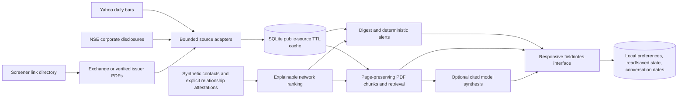

# Architecture, data provenance and privacy

## Foundational choices

One FastAPI process serves the API and static frontend, using SQLite in WAL mode. This keeps the demo portable and removes a separate frontend build, queue, vector database and cloud dependency. Requests use separate SQLite connections; source fetching is asynchronous with bounded concurrency. PDF extraction runs off the request event loop. Production needs an isolated extraction worker to enforce CPU/memory deadlines against hostile PDFs; cancelling a Python thread does not stop its underlying work.

The engine uses two clearly separated paths. Demo events and network profiles are fictional and deterministic. Research packs are short historical paraphrases with issuer citations. Live source failures do not cause synthetic fallback. Live source documents preserve PDF page numbers, source URLs, content hashes and fetch timestamps in the cache. Document IDs include a content hash, page and chunk position. A source being cached does not change its publication period.

Market cache TTL is 15 minutes; exchange announcements use five minutes; discovery uses one day; extracted documents use 30 days. Cache entries older than 30 days and filings older than 90 days are removed on startup. Signal snapshots also expire after 90 days unless saved. A saved market signal retains its observation even after another session arrives or the investor changes thresholds. These are public-source caches. Alert preferences, saved/read markers and conversation dates persist until the workspace database is reset by its owner. A single persisted record of contact dates is joined to the synthetic profiles; the demo does not accept arbitrary real-profile ingestion.

The brief refreshes when opened and the UI polls live mode every five minutes while visible. `FINN_BACKGROUND_LIVE=true` adds process-local polling at the configured interval (minimum five minutes). There is no durable scheduler, external push channel or delivery guarantee. Multiple service processes are outside this prototype’s operating model.

## Linking companies and people

NSE symbols are canonicalized, including `.NS` and symbols such as `M&M`. The portfolio has 18 companies across eight sectors and several size buckets. Live research accepts a validated NSE ticker independent of this set. The company universe is a demonstration watchlist, not a holdings valuation system.

Contact relevance combines exact employer, explicitly listed peer and topic matches. Tenure intervals must overlap to show a possible co-employment overlap. The system never turns overlap into a verified friendship or introduction. The second-degree CFO example uses an explicit, synthetic attestation keyed by stable person ID. Live filing titles are not enough to resolve a real person: production would require entity resolution across name, employer, role and dates, ambiguous-match review, and investor confirmation.

Ranking uses transparent category weights, a three-point context boost, or an eight-point boost for an explicitly attested path. This is attention priority, not an investment score. Threshold rules use strict “beyond” semantics. Undefined percentage changes and zero baselines are not turned into numerical growth claims.

## Research and models

Screener is used strictly as document discovery. Only exchange originals are accepted for unknown companies; a limited allowlist of issuer originals supports demonstration-company fallback. Secondary summaries, broker opinions, news and Screener ratios do not enter the retrieval corpus. Annual-report and transcript coverage is reported separately. Unsupported questions produce an evidence-gap notice.

Retrieval is a deterministic token-overlap baseline with small financial-topic expansions. It is cheap, inspectable and works without keys. It is not a production semantic ranking system. Text extraction can flatten tables or cut sentences; the original page remains the authority. Missing tables are not inferred from the model’s prior knowledge. Source text is treated as untrusted material, including when passed to the model.

Optional synthesis calls the OpenAI Responses API with `store=false`, a small bounded evidence set, a fixed prompt, a 1,400-output-token cap, a strict response schema and no tools. The default `gpt-4.1-mini` keeps this bounded task inexpensive. There is one model request per explicitly requested synthesis, no background LLM activity, and a per-process request limit. There are no autonomous agents. The API key remains server-side. The payload includes only the research question and retrieved public evidence; personal data should not be included in the question. Provider-side processing/retention terms still apply even when response storage is disabled.

Citation IDs must belong to retrieved evidence. A valid identifier does not prove that a model claim follows from a source; the UI says this explicitly. Production should add financial-unit/basis validation, quote entailment, reviewer feedback and an evaluation set before relying on synthesis.

## Security and consent

All people, roles, education details and relationship attestations are synthetic. No real network was scraped, no contact service was connected and no platform terms were bypassed. There are no analytics, remote fonts or third-party frontend scripts.

The default service binds to loopback. Non-local API access requires a bearer token; a trusted-host allowlist rejects unexpected hosts. Mutating requests reject foreign origins. The browser stores the entered token in tab-scoped session storage. Security headers restrict scripts, connections, embedding and object content. External text is escaped before rendering and links are limited to HTTPS. Data APIs return `Cache-Control: no-store`.

Public fetches are server-chosen, use HTTPS with system certificate verification, enforce exact host allowlists, revalidate every redirect, reject non-public DNS resolutions and impose payload/page limits. No API accepts an arbitrary fetch URL. This is defense in depth for a prototype, not a security certification; DNS rebinding, parser isolation, dependency updates and infrastructure egress restrictions need dedicated production review.

The single-user SQLite database is not encrypted by FINN. Keep the machine and storage private, and exclude `.env`, runtime databases, artifacts and personal exports from Git and shared storage. This workspace is inside OneDrive, so its runtime data may sync according to the owner’s settings. A real deployment should place `FINN_DB_PATH` on approved encrypted storage outside consumer synchronization if policy requires it.

For real network data, use explicit contact import or an authorized provider; record consent, provenance and allowed uses; minimize fields; allow relationship correction, export and deletion; enforce per-investor tenant keys and row-level authorization; encrypt database/backups; audit access without logging profile content; establish a documented retention period (for example, investor-controlled deletion plus a short backup expiry); and avoid sending private profiles to an external model by default. These are production design requirements, not features this prototype claims to implement.

## Cloud shape

The delivered code runs locally and uses no cloud account. The Dockerfile packages the same process for a small HTTPS-proxied host with a persistent disk. SQLite suits one instance; horizontal scaling would use PostgreSQL, isolated workers and a durable scheduler. Real public deployment needs SSO, tenant isolation, encrypted storage, provider licensing, an incident/retention policy, and monitored source freshness. Docker and hosting have not been exercised in this environment.
